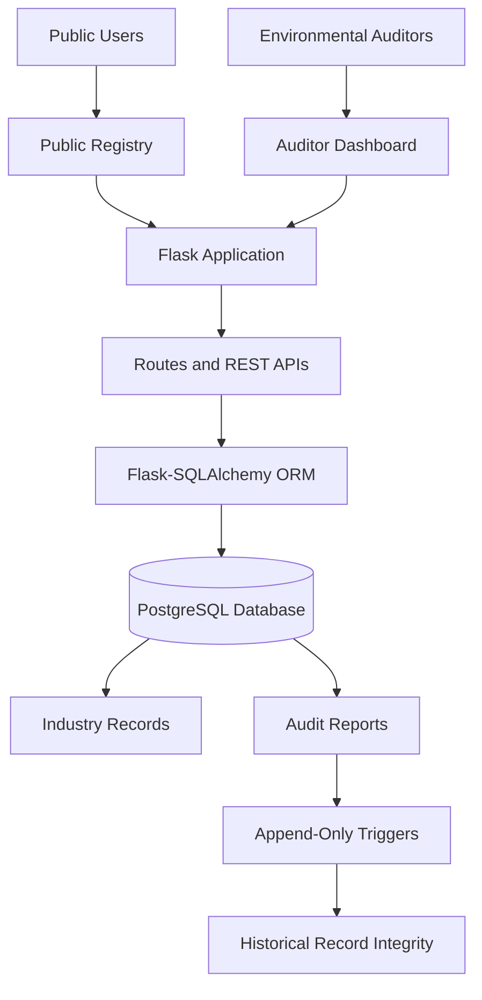
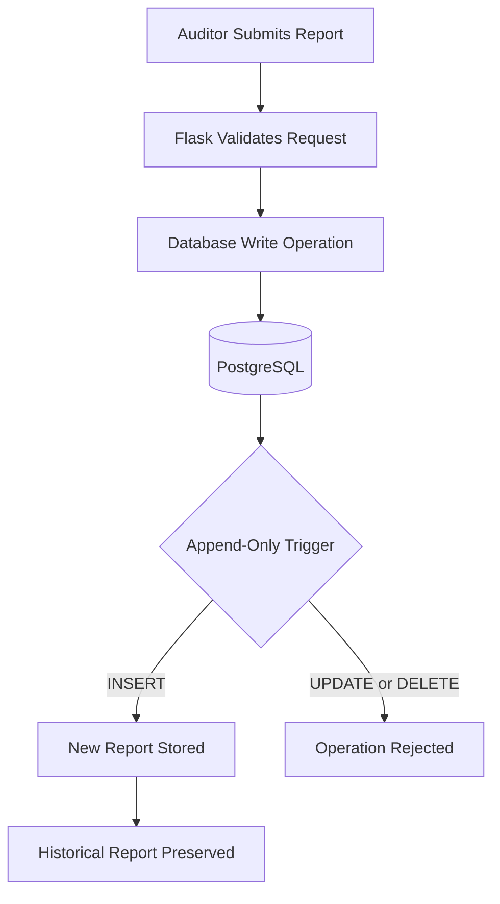

# BlueCred 🌱
### Industrial Environmental Compliance & Audit Verification Platform

A transparent environmental compliance platform for tracking industrial pollution, verifying environmental audits, and preserving historical compliance records through an append-only audit database architecture.

## 🚀 Live Demo

**[Visit BlueCred](https://bluecred-deployed.onrender.com)**

---

## 📌 Problem Statement

Industrial environmental compliance requires reliable pollution records, credible audit reports, and transparent access to verified information. When audit records can be modified or deleted without adequate controls, it becomes difficult to maintain trust, trace historical changes, and verify an industry's compliance history.

Traditional record-management systems may not provide sufficient safeguards against unauthorized changes to historical audit data. There is also a need for a centralized platform where auditors can manage reports and the public can explore industry compliance information.

### Key Problems Addressed

- **Record integrity:** Prevent unauthorized modification or deletion of historical audit reports.
- **Audit transparency:** Make industry information and audit reports accessible to the public.
- **Compliance monitoring:** Provide structured pollution records and industry compliance scores.
- **Centralized verification:** Enable auditors to manage audit reports through a dedicated dashboard.

## 💡 Proposed Solution

BlueCred provides a web-based platform connecting industry records, auditor workflows, and public access through a centralized application.

The solution combines an interactive public registry, authenticated auditor access, database-backed REST APIs, and PostgreSQL-based append-only protections for audit records.

Instead of relying on blockchain, the project uses database-level controls to restrict changes to historical audit reports. This approach demonstrates how database integrity mechanisms can strengthen the reliability of environmental compliance records.

---

## 🖼️ Project Preview


---

## ✨ Key Features

### 🌍 Public Industry Registry
- Browse registered industries and their compliance information.
- Search by industry name or industry ID.
- Filter industries by category and compliance score.
- Access available audit reports for individual industries.

### 🧑‍💼 Auditor Dashboard
- Authenticated auditor login.
- Create and manage audit reports.
- View industry records and compliance information.
- Access audit workflows through a dedicated dashboard.

### 🔒 Audit Record Integrity
- Append-only protections for historical audit reports.
- Database triggers to restrict unauthorized updates and deletions.
- Centralized storage of audit records in PostgreSQL.
- Database-level enforcement of integrity rules, independent of ordinary application-page controls.

### ⚙️ Backend and Deployment
- REST API endpoints for retrieving industry data.
- Database-backed dynamic dashboards.
- Cloud-hosted application and PostgreSQL database.
- GitHub-based version control and deployment workflow.

---

## 🏗️ System Architecture

The application follows a layered architecture that separates the user interface, Flask application logic, and database operations.



### Architecture Components

| Component | Responsibility |
|---|---|
| Public registry | Displays searchable industry and compliance information. |
| Auditor dashboard | Provides authenticated access to audit workflows. |
| Flask backend | Handles requests, routes, authentication, and application logic. |
| REST APIs | Transfer data between the frontend and backend. |
| SQLAlchemy ORM | Connects application models and database operations. |
| PostgreSQL | Stores industry, auditor, and audit report data. |
| Database triggers | Enforce configured restrictions on historical audit records. |

---

## 🔐 Append-Only Audit Architecture

Audit records are particularly important because they preserve the history of environmental assessments. BlueCred uses PostgreSQL database-level protections to restrict modifications and deletions of existing audit reports.



### How It Works

1. An authenticated auditor submits an audit report through the application.
2. Flask processes the request and interacts with PostgreSQL through SQLAlchemy.
3. PostgreSQL triggers enforce the configured append-only restrictions.
4. New reports can be recorded while prohibited changes to existing reports are rejected.
5. Historical audit records remain available for subsequent review.

**Security scope:** These controls protect against operations covered by the configured database triggers. They do not make the database absolutely tamper-proof; a sufficiently privileged database administrator may be able to disable or remove those protections. Hash chaining, digital signatures, and independent cryptographic verification should only be claimed if separately implemented.

---

## 🛠️ Technology Stack

### Backend
- Python
- Flask
- Flask-SQLAlchemy
- REST APIs
- SQLAlchemy ORM

### Frontend
- HTML5
- CSS3
- JavaScript
- Jinja2 Templates

### Database and Integrity
- PostgreSQL
- SQL
- Database Triggers
- Append-Only Audit Record Design

### Deployment and Version Control
- Render Cloud
- Gunicorn
- Git
- GitHub

---

## 📂 Project Structure

```text
Bluecredprogress/
├── app/
│   ├── routes/
│   ├── models/
│   ├── templates/
│   ├── static/
│   └── __init__.py
├── run.py
├── requirements.txt
├── Procfile
└── README.md
```

- `app/routes/` — application pages and request handlers.
- `app/models/` — database models.
- `app/templates/` — HTML templates.
- `app/static/` — CSS, JavaScript, and other static assets.
- `app/__init__.py` — Flask application factory and extension configuration.
- `run.py` — application entry point.

---

## ⚙️ Run Locally

### Prerequisites

- Python
- PostgreSQL database
- Git

### 1. Clone the repository

```bash
git clone https://github.com/devkaransingh1/Bluecredprogress.git
cd Bluecredprogress
```

### 2. Create and activate a virtual environment

```bash
python -m venv .venv
```

Linux/macOS:

```bash
source .venv/bin/activate
```

Windows:

```powershell
.venv\Scripts\Activate.ps1
```

### 3. Install dependencies

```bash
pip install -r requirements.txt
```

### 4. Configure environment variables

Configure these variables in your local environment or `.env` file, according to the application's configuration:

```env
DATABASE_URL=your_postgresql_connection_url
SECRET_KEY=your_generated_secret_key
```

Use your own database connection details and a securely generated secret key. Do not commit credentials or `.env` files to GitHub.

### 5. Start the application

```bash
python run.py
```

Open the local URL shown by Flask in your browser. For production, the application is served using Gunicorn.

---

## 📊 Database Design

BlueCred uses PostgreSQL to maintain structured environmental compliance information.

| Table | Purpose |
|---|---|
| Industries | Stores registered industry details and compliance information. |
| Auditors | Stores auditor account information. |
| Audit Reports | Stores audit findings and historical compliance reports. |

The append-only protections are applied to audit records through database-level triggers. Exact table fields and constraints depend on the implemented database schema.

---

## 🔮 Future Enhancements

- Cryptographic hash chaining and independent integrity verification.
- Digital signatures for stronger auditor attribution.
- More detailed environmental analytics and historical trend visualizations.
- Automated compliance alerts and reporting.
- Stronger separation of database privileges and administrative responsibilities.

These are potential extensions and should not be interpreted as features already implemented.

---

## 👨‍💻 Author

**Dev Karan Singh**  
Computer Science (Artificial Intelligence) Student

**Contributions:** Backend development, frontend development, PostgreSQL database design, audit record integrity controls, and cloud deployment.

- **GitHub:** [devkaransingh1](https://github.com/devkaransingh1)
- **Repository:** [Bluecredprogress](https://github.com/devkaransingh1/Bluecredprogress)
- **Live Application:** [bluecred-deployed.onrender.com](https://bluecred-deployed.onrender.com)

---

*BlueCred — Improving transparency and trust in industrial environmental compliance through structured digital records and database-level integrity controls.*
